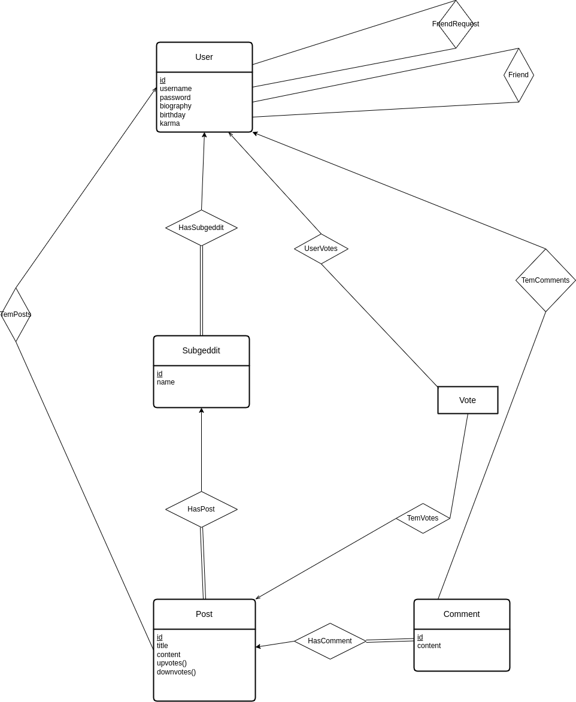

# UAlgeddit
---

## Conteúdo

- [UAlgeddit](#ualgeddit)
  - [Conteúdo](#conteúdo)
  - [Introdução](#introdução)
  - [Backend](#backend)
    - [Funcionalidades (Backend)](#funcionalidades-backend)
    - [Requisitos (Backend)](#requisitos-backend)
      - [Requisitos Funcionais (Backend)](#requisitos-funcionais-backend)
      - [Restrições (Backend)](#restrições-backend)
    - [API](#api)
      - [Auth](#auth)
      - [Subgeddit](#subgeddit)
      - [Posts](#posts)
      - [Comments](#comments)
      - [Profile](#profile)
      - [Friends](#friends)
      - [Chat](#chat)
    - [Base de Dados](#base-de-dados)
      - [Modelo Entidade Associação](#modelo-entidade-associação)
    - [Modelo Relacional](#modelo-relacional)
  - [Frontend](#frontend)
    - [Funcionalidades (Frontend)](#funcionalidades-frontend)
    - [Requisitos (Frontend)](#requisitos-frontend)
      - [Requisitos Funcionais (Frontend)](#requisitos-funcionais-frontend)
      - [Restrições (Frontend)](#restrições-frontend)
      - [Requisitos de Qualidade](#requisitos-de-qualidade)
    - [Layout](#layout)
    - [Set up](#set-up)
      - [Prerequisitos](#prerequisitos)
      - [Set up Backend](#set-up-backend)
      - [Set up Frontend](#set-up-frontend)
    - [Funcionalidades Extra](#funcionalidades-extra)
      - [Chat Global](#chat-global)
      - [Sistema de amizades](#sistema-de-amizades)
      - [Perfil e Karma](#perfil-e-karma)
  - [Considerações Finais](#considerações-finais)

---

## Introdução

Desenvolveu-se uma aplicação web com o intuito de facilitar a partilha de informação e interação entre indivíduos.
A aplicação denomina-se **"UAlgeddit"** e como o nome indica é uma aplicação semelhante ao Reddit.

---

## Backend

O backend inclui a API e a base de dados utilizados para tornar a aplicação uma realidade.

### Funcionalidades (Backend)

Através de HTTP requests é possível efetuar as seguintes operações:

* Efetuar login, recebendo um Json Web Token para manter o estado de autenticação.
* Efetuar registo de modo a criar conta na aplicação.
* Fazer logout, removendo o token do local storage e dando-lhe blacklist.
* É possível obter informações acerca de um utilizador.
* Um utilizador pode atualizar o seu perfil.
* É possível transmitir mensagens em tempo real a partir de uma websocket.
* É possível criar subgeddits (versão dos subreddits). O seu criador pode editá-los e removê-los também. Também é possível listar todos os subgeddits e obter detalhes acerca dos mesmos. Todas as operações CRUD estão disponíveis para esta entidade.
* É possível criar posts e o seu dono pode eliminá-los também. É também possível dar upvote ("like") ou downvote ("dislike"). Para além disso também dá para listar e obter detalhes acerca dos posts.
* É possível criar comentários e os comentadores podem eliminar os seus comentários. É possível listar todos os comentários para um determinado post.
* É possível enviar pedidos de amizade, listar os pedidos de amizade recebidos, aceitar e recusar pedidos de amizade. É também possível desfazer a amizade.

---

### Requisitos (Backend)

Os requisitos tratam-se das funcionalidades, qualidades e restrições contratuais às quais a aplicação tem de cumprir.

#### Requisitos Funcionais (Backend)

| ID    | Descrição                                                                                                                                                   |
| ----- | ----------------------------------------------------------------------------------------------------------------------------------------------------------- |
| RF-01 | O utilizador pode registar-se na plataforma                                                                                                                 |
| RF-02 | O utilizador pode autenticar-se na plataforma                                                                                                               |
| RF-03 | Aquando de um registo na plataforma é automaticamente criado um perfil para o utilizador                                                                    |
| RF-04 | O utilizador pode criar um subgeddit                                                                                                                        |
| RF-05 | O utilizador pode criar posts num subgeddit                                                                                                                 |
| RF-06 | O utilizador pode comentar qualquer post                                                                                                                    |
| RF-07 | O utilizador pode dar upvote nos posts                                                                                                                      |
| RF-08 | O utilizador pode dar downvote nos posts                                                                                                                    |
| RF-09 | O utilizador tem acesso a um feed com os posts dos vários subgeddits                                                                                        |
| RF-10 | O karma de um utilizador é definido de acordo com o número de upvotes e downvotes que recebeu nos seus posts de acordo com a fórmula: (upvotes - downvotes) |
| RF-11 | O utilizador pode consultar o seu perfil                                                                                                                    |
| RF-12 | O utilizador pode editar o seu perfil                                                                                                                       |
| RF-13 | O utilizador pode eliminar os seus comentários                                                                                                              |
| RF-14 | O utilizador pode eliminar os seus posts                                                                                                                    |
| RF-15 | O utilizador pode eliminar os seus subgeddits                                                                                                               |
| RF-16 | O utilizador pode modificar o seu perfil                                                                                                                    |
| RF-17 | O utilizador pode modificar os seus subgeddits                                                                                                              |
| RF-18 | O utilizador tem acesso a uma lista dos subgeddits                                                                                                          |
| RF-19 | O utilizador pode enviar pedidos de amizade a outros utilizadores                                                                                           |
| RF-20 | O utilizador pode aceitar pedidos de amizade                                                                                                                |
| RF-21 | A aplicação dispõe de um chat global entre todos os utilizadores conectados à aplicação                                                                     |

**Tabela 1:** Requisitos Funcionais do Backend

#### Restrições (Backend)

| ID   | Descrição                                                                                 |
| ---- | ----------------------------------------------------------------------------------------- |
| RC-1 | Toda a aplicação tem de ser desenvolvida recorrendo à linguagem de programação Typescript |
| RC-2 | É imperativa a utilização da framework Express para o desenvolvimento do backend          |
| RC-3 | A API interage com o sistema de gestão de base de dados SQLite                            |
| RC-4 | O backend tem de estar pronto antes do dia 20 de dezembro de 2025                         |

**Tabela 2:** Restrições do Backend

---

### API

A API foi desenvolvida recorrendo à linguagem de programação Typescript e à framework Express.
Segue a especificação dos endpoints da API e uma breve descrição de cada um.
Todos os endpoints excepto o de login e registo estão protegidos por um middleware que verifica se o utilizador está autenticado.

#### Auth

* `POST /auth/login` : Permite autenticar um utilizador.
* `POST /auth/register` : Permite registar um utilizador.
* `POST /auth/logout` : Efetua o logout de um utilizador.

#### Subgeddit

* `POST /subgeddit/create` : Permite criar um subgeddit.
* `POST /subgeddit/update/:id` : Permite modificar um subgeddit a partir do seu id.
* `GET /subgeddit/list` : Lista todos os subgeddits.
* `GET /subgeddit/detail/:id` : Permite obter detalhes acerca do subgeddit.
* `POST /subgeddit/delete/:id` : Permite eliminar o subgeddit.

#### Posts

* `POST /post/create` : Permite criar um post.
* `POST /post/delete/:id` : Permite eliminar um post.
* `GET /post/list` : Lista todos os posts.
* `POST /post/detail/:id` : Permite obter detalhes acerca do post.
* `POST /post/upvote/:id` : Permite dar upvote ao post.
* `POST /post/downvote/:id` : Permite dar downvote ao post.
* `POST /post/unvote/:id` : Permite remover o voto do post.

#### Comments

* `POST /comment/create` : Permite criar um comentário.
* `POST /comment/delete/:id` : Permite eliminar um comentário.
* `GET /comment/list/:pid` : Lista todos os comentários associados a um post.

#### Profile

* `GET /profile/view/:id` : Permite obter os detalhes do perfil do utilizador.
* `POST /profile/update` : Permite modificar os dados do perfil.

#### Friends

* `POST /friend/request` : Envia um pedido de amizade.
* `GET /friend/list` : Lista os pedidos de amizade recebidos.
* `POST /friend/request/accept` : Aceita um pedido de amizade.
* `POST /friend/request/decline` : Rejeita um pedido de amizade.
* `POST /friend/unfriend` : Termina uma amizade.

#### Chat

* `WS /chat/global` : Websocket para comunicação em tempo real entre utilizadores.

---

### Base de Dados

De modo a desenvolver uma base de dados seguindo as melhores práticas desenvolveu-se um modelo relacional e entidade relação.
O sistema de gestão de base de dados utilizado foi SQLite.

#### Modelo Entidade Associação



---

### Modelo Relacional

```
User(id, username, password, karma, biography, birthday)
NN(username)
NN(password)
NN(karma)
RI: O karma tem de ser maior ou igual zero.
RI: O birthday tem de ser antes da data atual.

Subgeddit(id, name, user_id)
FK(user_id) → User
NN(name)
NN(user_id)

Post(id, title, content, subgeddit_id, user_id)
FK(subgeddit_id) → Subgeddit
FK(user_id) → User
NN(title)
NN(content)
NN(subgeddit_id)
NN(user_id)

Comment(id, content, post_id, user_id)
FK(post_id) → Post
FK(user_id) → User
NN(content)
NN(post_id)
NN(user_id)

FriendRequest(from, to)
FK(from) → User
FK(to) → User

Friend(user_id, friend_id)
FK(user_id) → User
FK(friend_id) → User

Vote(post_id, user_id, num)
FK(user_id) → User
NN(num)
RI: num só pode ser -1 (downvote) ou 1 (upvote)
```

---

## Frontend

### Funcionalidades (Frontend)

* Barra de navegação para navegação intuitiva.
* Página inicial com descrição da aplicação.
* Página de listagem de subgeddits.
* Página de criação de subgeddits.
* Página de detalhes de um subgeddit.
* Página de criação de posts.
* Página de atualização de subgeddits.
* Página de feed com todos os posts.
* Página de chat em tempo real.
* Página de perfil do utilizador.
* Página de perfil de outros utilizadores com sistema de amizades.

---

### Requisitos (Frontend)

#### Requisitos Funcionais (Frontend)

| ID | Descrição |
|----|-----------|
| RF-1 | O utilizador pode navegar na aplicação a partir de uma barra de navegação. |
| RF-2 | O utilizador pode navegar para a HomePage. |
| RF-3 | O utilizador pode navegar para uma página que permita a visualização de uma lista de subgeddits. |
| RF-4 | O utilizador pode navegar para uma página que permita a criação de um subgeddit. |
| RF-5 | O utilizador pode navegar para uma página que permita o update de um subgeddit. |
| RF-6 | Na página de listagem de subgeddits o utilizador deve poder apagar ou dar update a um subgeddit. |
| RF-7 | A partir da página de listagem de subgeddits é possível navegar até ao perfil do dono do subgeddit. |
| RF-8 | A partir da página de listagem de subgeddits é possível criar um post para um subgeddit em específico. |
| RF-9 | A partir da página de listagem de subgeddits, ao clicar num subgeddit, é possível filtrar a listagem de posts para um subgeddit em específico. |
| RF-10 | O utilizador pode navegar para uma página que permita a visualização de um feed com todos os posts dos vários subgeddits. |
| RF-11 | A partir da listagem de posts é possível navegar para a página com os detalhes do subgeddit ao qual o post pertence. |
| RF-12 | A partir da listagem de posts é possível navegar para a página com as informações acerca de um utilizador, isto é, visualizar o seu perfil. |
| RF-13 | Na página de listagem de posts é possível visualizar o número de upvotes e downvotes de um post. |
| RF-14 | Na página de listagem de posts, ao clicar num post, somos redirecionados para uma página com detalhes acerca do post. |
| RF-15 | É possível navegar para uma página com detalhes acerca dos posts. |
| RF-16 | Na página com os detalhes de um post é possível dar upvote ao post. |
| RF-17 | Na página com os detalhes de um post é possível dar downvote ao post. |
| RF-18 | Na página com os detalhes de um post é possível remover o upvote ou downvote de um post. |
| RF-19 | Na página com os detalhes de um post é possível criar um comentário para o post. |
| RF-20 | Na página com os detalhes de um post é possível visualizar uma lista com todos os comentários. |
| RF-21 | Na página com os detalhes de um post é eliminar um comentário caso sejamos os criadores desse comentário. |
| RF-22 | Na página com os detalhes de um post é eliminar o post caso sejamos os criadores do post. |
| RF-23 | É possível navegar até uma página na qual existe um chat global entre os utilizadores. |
| RF-24 | Na página com o chat global é possível enviar mensagens para todos os utilizadores conectados ao chat. |
| RF-25 | Na página com o chat global é possível navegar para um perfil de um utilizador que tenha enviado mensagem. |
| RF-26 | É possível navegar para uma página com o perfil de outros utilizadores. |
| RF-27 | Um utilizador pode navegar para uma página com o seu perfil. |
| RF-28 | Um utilizador pode dar update ao seu perfil na página com o seu perfil. |
| RF-29 | Um utilizador pode visualizar os pedidos de amizade recebidos na página com o seu perfil. |
| RF-30 | Um utilizador pode aceitar os pedidos de amizade recebidos na página com o seu perfil. |
| RF-31 | Um utilizador pode rejeitar os pedidos de amizade recebidos na página com o seu perfil. |
| RF-32 | Na barra de navegação existe um botão que dá logout ao utilizador. |

**Tabela 3:** Requisitos Funcionais do Frontend


#### Restrições (Frontend)

| ID   | Descrição                                                                                 |
| ---- | ----------------------------------------------------------------------------------------- |
| RC-1 | Toda a aplicação tem de ser desenvolvida recorrendo à linguagem de programação Typescript |
| RC-2 | É imperativa a utilização da framework React                                              |
| RC-3 | O frontend tem de estar pronto antes do dia 20 de dezembro de 2025                        |

**Tabela 4:** Restrições do Frontend

#### Requisitos de Qualidade

| ID   | Descrição                                         |
| ---- | ------------------------------------------------- |
| RQ-1 | O frontend deve ser intuitivo e fácil de utilizar |
| RQ-2 | O frontend deve ter uma palete de cores agradável |
| RQ-3 | O frontend deve ser dinâmico e responsivo         |

---

### Layout

O layout da aplicação é simples e intuitivo, com barra de navegação presente em todas as páginas, utilização de grid CSS e efeitos hover para maior interatividade.

---

### Set up

#### Prerequisitos

* Node.js instalado

#### Set up Backend

```bash
cd ./server
npm install
npm start
```

#### Set up Frontend

```bash
cd ./client
npm install
npm run dev
```

---

### Funcionalidades Extra

#### Chat Global

Comunicação em tempo real através de websocket entre todos os utilizadores.

#### Sistema de amizades

Sistema completo de pedidos, aceitação, rejeição e remoção de amizades.

#### Perfil e Karma

Sistema de karma baseado em upvotes e downvotes, suportado por triggers na base de dados.

---

## Considerações Finais

A aplicação foi desenvolvida recorrendo aos conhecimentos de Typescript, HTML, CSS, React e Express.
O projeto permitiu aprofundar conhecimentos de backend, frontend, bases de dados e integração entre sistemas, consolidando aprendizagens adquiridas ao longo do curso de Engenharia Informática.
