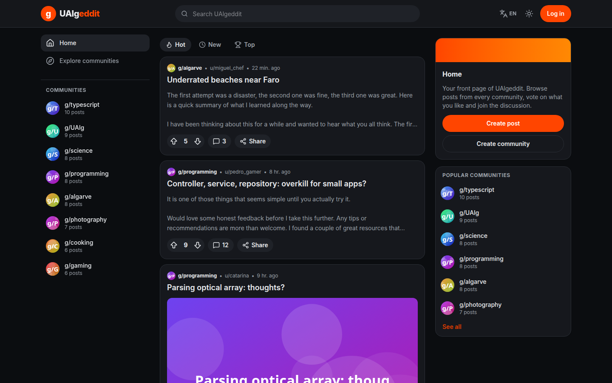
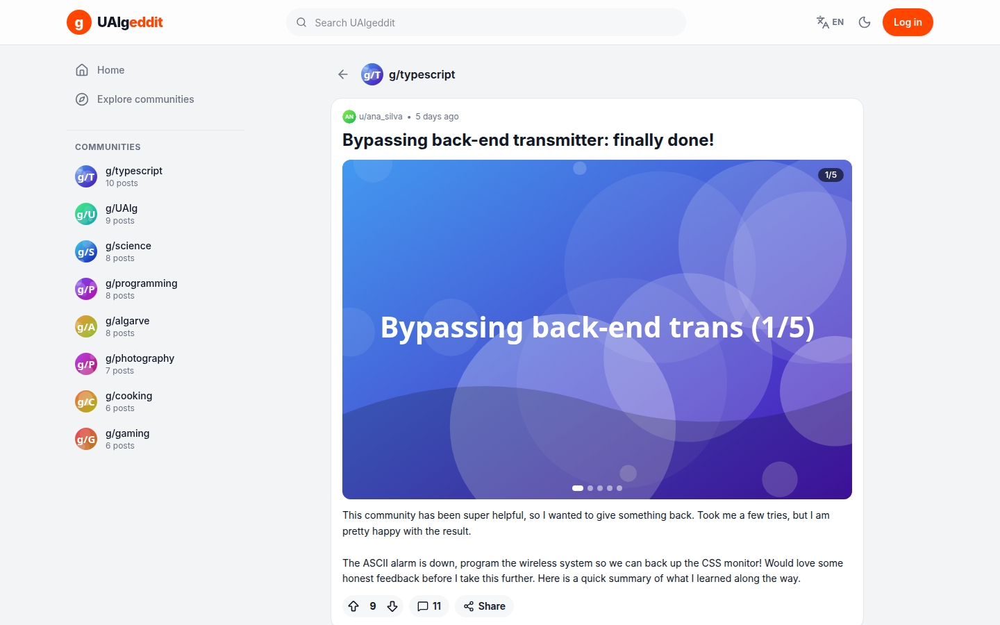

<div align="center">


# UAlgeddit

**A Reddit-style community platform: communities, image posts, threaded discussions, votes, friends and real-time chat.**

[](https://github.com/edagener0/UAlgeddit/actions/workflows/ci.yml)
[](https://github.com/edagener0/UAlgeddit/actions/workflows/docker.yml)


</div>

<p align="center">
  
  
</p>

---

## Contents

- [Features](#features)
- [Tech stack](#tech-stack)
- [Quick start (Docker)](#quick-start-docker)
- [Local development](#local-development)
- [Make targets](#make-targets)
- [Project structure](#project-structure)
- [API documentation](#api-documentation)
- [Testing and CI](#testing-and-ci)
- [Configuration](#configuration)
- [Documentation](#documentation)
- [Contributing](#contributing)

## Features

| Area              | What you get                                                                                                                                  |
| ----------------- | --------------------------------------------------------------------------------------------------------------------------------------------- |
| **Communities**   | Create _subgeddits_ with an icon, a banner and a description; owners can edit or delete them.                                                 |
| **Posts**         | Title, text and up to **10 images** per post, shown in a swipeable gallery with a full-screen lightbox.                                       |
| **Feeds**         | Home, community and profile feeds sorted by **Hot / New / Top**, infinite scroll and full-text search.                                        |
| **Discussions**   | Threaded comments (nested replies), up to 4 images per comment, collapsible threads, soft delete.                                             |
| **Votes & karma** | Up/down votes on posts and comments with optimistic UI; karma is updated transactionally.                                                     |
| **Social**        | Profiles with avatar, bio and birthday; friend requests (send, accept, decline, cancel) and friend lists.                                     |
| **Account**       | Change password (signs out other devices) and permanently delete the account with all of its content.                                         |
| **Chat**          | Global real-time chat over WebSockets with history, presence and automatic reconnection.                                                      |
| **UX**            | Fully responsive, accessible, light/dark themes with an animated switch, English / Português / Français.                                      |
| **Security**      | httpOnly `__Host-` cookies, session revocation, layered rate limits, image re-encoding (EXIF/GPS stripped), CSP, hardened containers, CodeQL. |

## Tech stack

| Layer        | Technologies                                                                                           |
| ------------ | ------------------------------------------------------------------------------------------------------ |
| **Frontend** | React 19, Vite, Tailwind CSS v4, TanStack Query, React Router, react-hook-form + Zod, i18next          |
| **Backend**  | Node.js 22, Express 5, Prisma ORM, PostgreSQL 17, `ws`, pino, helmet, multer, Swagger UI (OpenAPI 3.1) |
| **Shared**   | `@ualgeddit/shared`: Zod schemas, DTO types and constants used by both apps                            |
| **Quality**  | TypeScript (strict), ESLint, Prettier, Vitest, Testing Library, Supertest                              |
| **Delivery** | Docker (multi-stage, non-root), Docker Compose, nginx, GitHub Actions, Dependabot, Makefile            |

## Quick start (Docker)

Requirements: **Docker** with Compose v2 and **make**.

```bash
git clone https://github.com/edagener0/UAlgeddit.git
cd UAlgeddit
make up
```

`make up` creates a `.env` with a random `JWT_SECRET`, builds the images, applies the database migrations and starts:

The web app is served on [http://localhost:8080](http://localhost:8080). This is the production configuration, so
the Swagger UI is **not** exposed; use the development setup below to browse the API docs.

The application starts **empty**: register an account and create the first community. If you want demo content
for local testing, run `make docker-seed` (this **wipes** the database first). Stop everything with `make down`.

## Local development

Requirements: **Node.js ≥ 22.12**, **npm**, **Docker** (for PostgreSQL) and **make**.

```bash
make setup   # install dependencies, start PostgreSQL, apply migrations
make dev     # API on :3000 and web on :5173 with hot reload
```

Open [http://localhost:5173](http://localhost:5173). Vite proxies `/api`, the chat WebSocket and `/uploads` to the
API, so the browser always talks to a single origin and the session cookie just works.

## Make targets

Run `make help` for the full list.

| Target                           | Description                                            |
| -------------------------------- | ------------------------------------------------------ |
| `make setup`                     | Install dependencies, start PostgreSQL, run migrations |
| `make dev`                       | Start the API and the web client with hot reload       |
| `make up` / `make down`          | Start / stop the production stack with Docker Compose  |
| `make migrate`                   | Create and apply a migration after editing the schema  |
| `make seed` / `make docker-seed` | _(Optional)_ wipe the database and load demo data      |
| `make studio`                    | Open Prisma Studio                                     |
| `make lint` / `make format`      | ESLint / Prettier                                      |
| `make typecheck`                 | TypeScript in every workspace                          |
| `make test` / `make coverage`    | Unit tests (with coverage)                             |
| `make ci`                        | Everything CI runs, locally                            |
| `make erd`                       | Export the draw.io ER diagram to SVG/PNG               |
| `make report`                    | Build the project report PDF (LaTeX)                   |

## Project structure

```
.
├── apps/
│   ├── api/                  # Express REST + WebSocket API
│   │   ├── prisma/           # schema.prisma, migrations, optional seed
│   │   └── src/
│   │       ├── common/       # errors, middleware (auth, uploads, rate limit…), utils
│   │       ├── config/       # environment validation (zod)
│   │       ├── docs/         # OpenAPI document builder
│   │       ├── modules/      # one folder per domain:
│   │       │   └── posts/    #   *.routes → *.controller → *.service → *.repository (+ *.docs, *.test)
│   │       ├── app.ts        # Express app factory
│   │       ├── container.ts  # composition root (dependency injection)
│   │       └── main.ts       # bootstrap and graceful shutdown
│   └── web/                  # React single-page application
│       └── src/
│           ├── components/   # UI primitives, layout, gallery, image picker…
│           ├── features/     # auth, posts, comments, subgeddits, users, friends, chat
│           ├── i18n/         # i18next setup and en / pt / fr catalogues
│           └── lib/          # API client, query client, utilities
├── packages/shared/          # Zod schemas + DTO types shared by API and web
├── docs/                     # architecture, API, database, development, report
├── .github/                  # CI, Docker workflow, Dependabot
├── docker-compose.yml
└── Makefile
```

## API documentation

In development (`make dev`), interactive Swagger UI is served at
**[http://localhost:3000/api/docs](http://localhost:3000/api/docs)** (raw spec: `/api/docs/openapi.json`). The docs are
**disabled in production** (`NODE_ENV=production`, as in the Docker stack); set `API_DOCS_ENABLED=true` to force them on.
Request schemas are
generated from the same Zod schemas used for validation, so the documentation cannot drift from the code. See
[docs/api.md](docs/api.md) for an overview, the error format and the WebSocket protocol.

## Testing and CI

```bash
make test       # shared, API and web unit tests
make coverage   # with coverage reports
make ci         # format check, lint, typecheck, tests and build
```

GitHub Actions run on every push and pull request:

- **CI**: Prettier, ESLint, TypeScript, unit tests (shared / API / web, coverage uploaded as artifacts), migrations
  and seed against a real PostgreSQL service, production build.
- **Docker**: builds both images and smoke-tests the full Compose stack through nginx.
- **CodeQL** static analysis and a dependency audit gate (`npm audit --audit-level=high`).
- **Dependabot**: weekly npm updates, monthly GitHub Actions and base-image updates.

## Configuration

Docker Compose reads the root `.env` (see [`.env.example`](.env.example)); the API in development reads
[`apps/api/.env`](apps/api/.env.example). `make env` creates both with random secrets.

| Variable             | Default                     | Description                                             |
| -------------------- | --------------------------- | ------------------------------------------------------- |
| `JWT_SECRET`         | _(required)_                | ≥ 32 random characters used to sign session tokens      |
| `JWT_EXPIRES_IN`     | `7d`                        | Session lifetime (`15m`, `12h`, `7d`…)                  |
| `DATABASE_URL`       | local PostgreSQL            | PostgreSQL connection string                            |
| `CORS_ORIGINS`       | `http://localhost:5173`     | Comma-separated browser origins allowed to call the API |
| `COOKIE_SECURE`      | `false`                     | Set to `true` when served over HTTPS                    |
| `TRUST_PROXY`        | `0`                         | Number of reverse proxies in front of the API           |
| `UPLOAD_DIR`         | `uploads`                   | Where uploaded images are stored                        |
| `API_PORT`           | `3000`                      | API port                                                |
| `RATE_LIMIT_ENABLED` | `true`                      | Toggle rate limiting                                    |
| `API_DOCS_ENABLED`   | `true` except in production | Serve Swagger UI at `/api/docs`                         |

## Documentation

| Document                                 | Contents                                                     |
| ---------------------------------------- | ------------------------------------------------------------ |
| [Architecture](docs/architecture.md)     | Monorepo layout, layered backend, frontend, security model   |
| [Database](docs/database.md)             | ER diagram (draw.io), relational model, constraints, indexes |
| [API](docs/api.md)                       | Endpoints, authentication, errors, pagination, WebSocket     |
| [Development](docs/development.md)       | Workflow, scripts, migrations, testing, commit conventions   |
| [Security](docs/security.md)             | Security model, audit findings and recommendations           |
| [Deployment](docs/deployment.md)         | Docker images, configuration, production checklist           |
| [Project report](docs/report/report.pdf) | Full academic report (LaTeX source in `docs/report`)         |

## Contributing

Contributions are welcome. Please read [CONTRIBUTING.md](CONTRIBUTING.md): in short, branch from `main`, follow
[Conventional Commits](https://www.conventionalcommits.org/), and make sure `make ci` passes.
