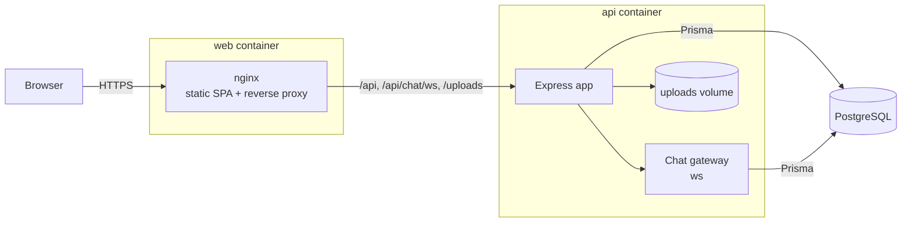
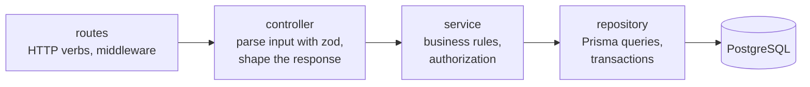
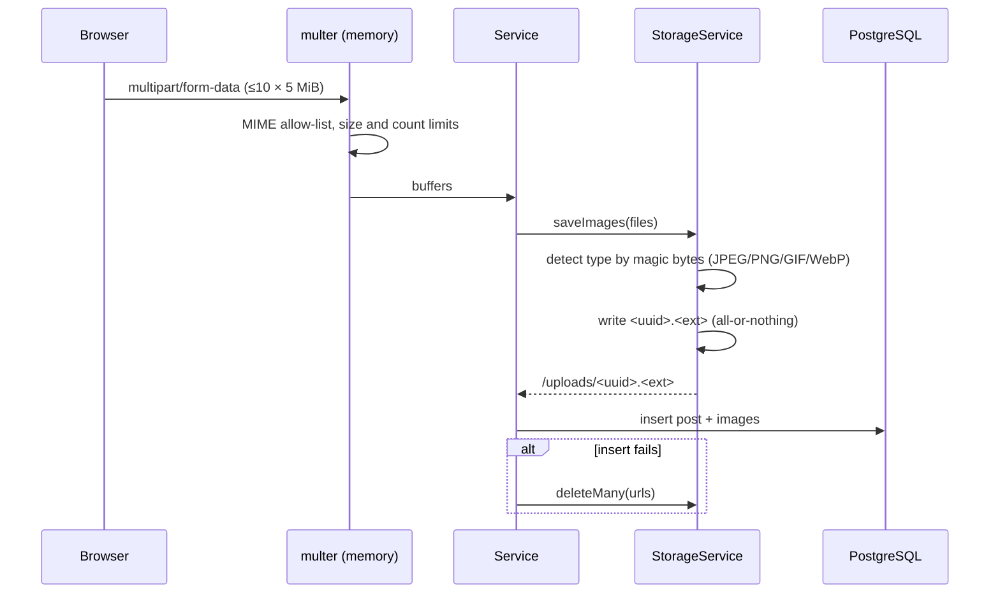

# Architecture

UAlgeddit is a TypeScript monorepo managed with **npm workspaces**:

| Workspace         | Package             | Role                                                   |
| ----------------- | ------------------- | ------------------------------------------------------ |
| `apps/api`        | `@ualgeddit/api`    | REST + WebSocket API (Express 5, Prisma, PostgreSQL)   |
| `apps/web`        | `@ualgeddit/web`    | Single-page application (React 19, Vite, Tailwind CSS) |
| `packages/shared` | `@ualgeddit/shared` | Zod schemas, DTO types and constants used by both apps |

The shared package ships TypeScript sources. Vite and Vitest consume them directly, and the API bundles them with
`tsup` at build time, so there is no separate build step and no way for the two apps to drift apart.



In production the browser only talks to **one origin** (nginx), which serves the static bundle and proxies `/api`,
the chat WebSocket and `/uploads` to the API. In development the Vite dev server plays the same role.

## Backend

### Layers

Each domain lives in `apps/api/src/modules/<domain>` and is split into four layers with a single responsibility each:



| Layer          | Knows about                        | Must not                   |
| -------------- | ---------------------------------- | -------------------------- |
| **Routes**     | URLs, middleware order             | contain logic              |
| **Controller** | `req`/`res`, shared zod schemas    | talk to the database       |
| **Service**    | domain rules, ownership, errors    | know about HTTP or Express |
| **Repository** | Prisma, SQL concerns, transactions | make business decisions    |

Domains: `auth`, `users`, `subgeddits`, `posts`, `comments`, `friends`, `chat` and `storage`. Each also has a
`*.docs.ts` file (its OpenAPI paths) and `*.test.ts` unit tests.

`container.ts` is the **composition root**: the only place that instantiates concrete classes and wires
repositories into services and services into controllers. Services receive their collaborators through constructor
injection, which makes them trivially unit-testable with mocks.

### Request lifecycle

1. `pino-http` assigns a request id and logs the request (secrets redacted).
2. `helmet` sets security headers; `cors` only allows configured origins (with credentials).
3. `express.json` (100 kB limit) and `cookie-parser` parse the request.
4. On `/api`: the global **rate limiter**, the **origin check** (CSRF defence) and `optionalAuth`, which resolves
   `req.user` from the session cookie.
5. The domain router runs `requireAuth` and the upload middleware where needed, then the controller.
6. Thrown errors reach the **central error handler**, which maps `AppError`s, Zod, Prisma, Multer and body-parser
   errors to a consistent JSON body, and hides unexpected errors behind a generic 500.

### Authentication

- Passwords are hashed with **bcrypt** (cost 12, max 72 bytes enforced by validation).
- Login and register set a signed **JWT in an httpOnly, `SameSite=Lax` cookie** (`Secure` behind HTTPS). The token
  is never returned in a response body and `Authorization` headers are ignored, so JavaScript can never read it.
- Each token carries the user's `token_version`. Logging out increments it, which **revokes every session** of the
  user; the auth middleware checks the version on every request.
- Login always runs bcrypt (against a dummy hash for unknown users) and returns the same error, so neither the
  response nor its timing reveals whether a username exists.
- Login/register have a stricter rate limit (30 per 15 minutes per IP).

### Images



- The client-provided MIME type and file name are never trusted; SVG and HTML are rejected.
- Every image is decoded and re-encoded to WebP with `sharp`: metadata (EXIF/GPS) is stripped, orientation
  applied, dimensions bounded (content 2048 px, avatars/icons 512 px, banners 1920×640) and decoding capped at 40 MP.
- Files get random UUID names; the storage only deletes names it generated (no path traversal).
- `/uploads` is served with `Content-Security-Policy: default-src 'none'; sandbox`, `nosniff` and long caching.
- `StorageService` is an interface: the local-disk implementation could be replaced by S3 without touching services.

### Votes, karma and ranking

A vote is a single interactive transaction: read the previous vote, upsert or delete it, add the delta
(`next - previous`) to the post/comment score and to the author's karma, and recompute the post's **hot rank**:

```
hot = sign(score) · log10(max(|score|, 1)) + (created_at − epoch) / 45000
```

The score, the hot rank and the comment count are **denormalised** so feeds can be sorted and paginated with
indexes instead of aggregating votes on every request.

### Comments

Comments store `parent_id` and `depth` (max 8). The service loads a post's comments in one query and builds the
tree in memory (`buildCommentTree`), sorting every level. Deleting a comment is a **soft delete**: the row stays so
replies keep their place, shown as "[deleted]"; deleted leaves are pruned from the tree.

### Real-time chat

`ChatGateway` handles WebSocket upgrades on `/api/chat/ws` itself (no Express middleware runs on upgrades). It:

- checks the `Origin` against the allow-list and authenticates the session cookie with the same `AuthService`;
- validates every incoming event with the shared zod schema (4 kB max payload);
- rate limits each connection (5 messages per 5 s), persists messages, then broadcasts them;
- broadcasts presence (distinct online users) and pings clients every 30 s to drop dead connections.

### Operational concerns

- Configuration is validated with zod at startup (`config/env.ts`): the API refuses to start with a weak secret.
- Swagger UI (`/api/docs`) is only mounted outside production (`API_DOCS_ENABLED`).
- `GET /api/health` checks the database and is used by Docker health checks.
- `SIGTERM`/`SIGINT` close the WebSocket server, stop accepting connections, then disconnect Prisma.

## Frontend

```
src/
├── components/   ui primitives (button, field, dialog, dropdown…), layout, gallery, image picker, votes
├── features/     one folder per domain: api.ts (HTTP calls), hooks.ts (TanStack Query), pages and components
├── hooks/        theme, debounce, object URLs
├── i18n/         i18next setup + en / pt / fr catalogues
├── lib/          API client, query client, utilities
└── router.tsx    routes (lazy-loaded pages, auth guard)
```

- **Server state** lives in TanStack Query. Query keys are centralised per feature; mutations update caches
  surgically (for example, a vote patches the post in every cached feed page and in its detail view, optimistically).
- **Forms** use react-hook-form with the **shared zod schemas**, so the client and the API validate with the same rules.
- **Styling** uses Tailwind CSS v4 with semantic design tokens (`bg-surface`, `text-fg-muted`…) that switch between
  light and dark themes. Theme switching is animated with the View Transitions API (circular reveal), with a
  cross-fade fallback, and respects `prefers-reduced-motion`.
- **i18n**: i18next detects the browser language (`pt-BR` → Portuguese, `fr-CA` → French, otherwise English) and
  remembers manual choices. Validation and API messages (English) are translated through a `messages` catalogue.
- **Routing**: React Router data router with lazy-loaded pages and vendor chunks for long-term caching.
- **Accessibility**: semantic landmarks, labelled controls, keyboard-operable gallery/lightbox/menus, focus styles,
  skip link, `aria-live` chat.

## Security summary

See [security.md](security.md) for the full list of controls and the audit findings.

| Threat                  | Mitigation                                                                      |
| ----------------------- | ------------------------------------------------------------------------------- |
| Token theft via XSS     | httpOnly cookie, strict CSP (no inline scripts), React escaping                 |
| CSRF                    | `SameSite=Lax` cookie, origin check on state-changing requests, CORS allow-list |
| Session reuse           | Token version revocation on logout, short-lived configurable expiry             |
| Brute force / abuse     | Rate limits (global, auth, chat), bcrypt cost 12                                |
| User enumeration        | Constant-work login with a generic error                                        |
| Malicious uploads       | Magic-byte validation, random names, sandboxing CSP, size/count limits          |
| Injection               | Prisma parameterised queries, zod validation of every input                     |
| Information leakage     | Generic 500 responses, redacted logs, `x-powered-by` disabled                   |
| Container escape impact | Non-root API and nginx images, minimal Alpine bases                             |
