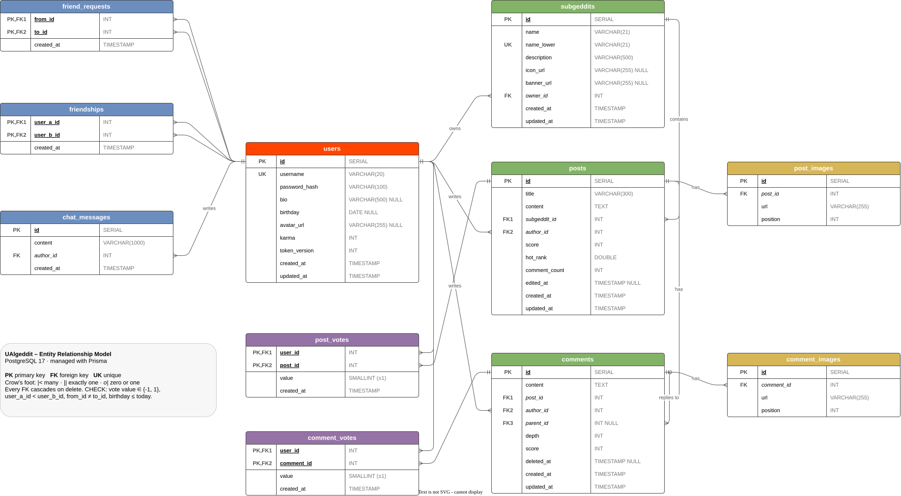

# Database

UAlgeddit uses **PostgreSQL 17** through **Prisma ORM**. The schema lives in
[`apps/api/prisma/schema.prisma`](../apps/api/prisma/schema.prisma) and every change is captured as a versioned SQL
migration in [`apps/api/prisma/migrations`](../apps/api/prisma/migrations).

## Entity relationship model

The diagram is drawn with **draw.io**: edit [`diagrams/er-diagram.drawio`](diagrams/er-diagram.drawio) (desktop app
or the VS Code extension) and re-export it with `make erd`.



## Relational model

Underlined attributes are primary keys; `→` marks foreign keys. Every foreign key cascades on delete.

```
users(id, username UNIQUE, password_hash, bio?, birthday?, avatar_url?, karma, token_version, created_at, updated_at)

subgeddits(id, name, name_lower UNIQUE, description, icon_url?, banner_url?, owner_id → users, created_at, updated_at)

posts(id, title, content, subgeddit_id → subgeddits, author_id → users,
      score, hot_rank, comment_count, edited_at?, created_at, updated_at)

post_images(id, post_id → posts, url, position)            UNIQUE(post_id, position)

comments(id, content, post_id → posts, author_id → users, parent_id? → comments,
         depth, score, deleted_at?, created_at, updated_at)

comment_images(id, comment_id → comments, url, position)    UNIQUE(comment_id, position)

post_votes(user_id → users, post_id → posts, value, created_at)          PK(user_id, post_id)
comment_votes(user_id → users, comment_id → comments, value, created_at) PK(user_id, comment_id)

friend_requests(from_id → users, to_id → users, created_at)   PK(from_id, to_id)
friendships(user_a_id → users, user_b_id → users, created_at) PK(user_a_id, user_b_id)

chat_messages(id, content, author_id → users, created_at)
```

## Integrity rules

| Rule                                                          | Enforced by                        |
| ------------------------------------------------------------- | ---------------------------------- |
| Usernames are unique (case-insensitive lookups)               | unique index + service check       |
| Community names are unique regardless of case                 | unique `name_lower`                |
| A vote is either +1 or −1 (no vote = no row)                  | `CHECK (value IN (-1, 1))`         |
| A user votes at most once per post / comment                  | composite primary keys             |
| A friendship is stored once, in canonical order               | `CHECK (user_a_id < user_b_id)`    |
| Nobody can send a friend request to themselves                | `CHECK (from_id <> to_id)`         |
| Birthdays are not in the future                               | `CHECK (birthday <= CURRENT_DATE)` |
| Image positions are non-negative and unique per post/comment  | `CHECK` + unique index             |
| Comment depth is non-negative (max 8 enforced by the service) | `CHECK (depth >= 0)` + service     |

The `CHECK` constraints are added by hand to the initial migration because Prisma's schema language cannot express them.

## Design decisions

- **Denormalised counters**: `posts.score`, `posts.hot_rank`, `posts.comment_count`, `comments.score` and
  `users.karma` are maintained inside the same transactions that change votes and comments. Feeds sort and paginate
  on indexed columns instead of aggregating votes per request.
- **Hot ranking** is stored (`hot_rank`) and recomputed on every score change, so "Hot" is a simple indexed sort.
- **Soft-deleted comments** (`deleted_at`) keep reply threads intact; their content and images are removed.
- **Canonical friendships**: one row per pair (`user_a_id < user_b_id`) avoids duplicate or asymmetric data.
- **`token_version`** lets the API revoke every JWT of a user (logout) without a token blacklist table.
- **`edited_at`** is set explicitly when the author edits a post; `updated_at` also changes on votes.

## Indexes

Beyond primary keys and unique constraints: `posts(subgeddit_id, created_at)`, `posts(author_id)`,
`posts(hot_rank)`, `posts(score)`, `posts(created_at)`, `comments(post_id)`, `comments(parent_id)`,
`comments(author_id)`, `post_votes(post_id)`, `comment_votes(comment_id)`, `friend_requests(to_id)`,
`friendships(user_b_id)`, `subgeddits(owner_id)` and `chat_messages(created_at)`.

## Working with migrations

```bash
# 1. edit apps/api/prisma/schema.prisma
make migrate            # creates and applies a new migration (prisma migrate dev)
make migrate-deploy     # applies pending migrations (what the Docker image does on start-up)
make studio             # browse the data
```

The CI `database` job applies every migration to a fresh PostgreSQL and fails if the schema and the migrations
diverge (`prisma migrate diff --exit-code`).
